# Ethereum Hexagonal ETL

An educational Ethereum data pipeline written in Go: **Extract → Transform → Load**.
It fetches complete block snapshots, validates and normalizes them, and persists
queryable records. The purpose is to study reliable ingestion across process and
database failures, using three small services with explicit boundaries.

Implementation Stages 0–14.5 and the final static review are complete. Stage 15
adds teaching material and comments, without changing application behavior.
[Offline validation passed](docs/architecture/validation-offline-stage14.md),
[performance was accepted for the educational scope](docs/architecture/validation-performance-stage14.md),
and [one bounded live block plus no-RPC recovery passed](docs/architecture/validation-live-stage14.md).
These records retain their original failures, reruns and limitations. They do not
certify unrestricted production use or a later revision's hosted CI. The previous
single live authorization is consumed; documentation is not permission to repeat it.

## Start here

1. [Run the synthetic local pipeline](#local-development-without-live-ethereum-rpc).
2. Follow the [twelve-step data flow](#data-flow-and-transaction-boundaries).
3. Read the [service guides](#service-responsibilities) alongside their source files.
4. Work through the [learning guides](docs/learning/README.md) and accepted ADRs.
5. Use the [runtime reference](docs/reference/runtime-reference.md) for complete
   configuration tables, standalone service commands, migrations and operator modes.

The system implements Ethereum Mainnet JSON-RPC acquisition, exact raw result-byte
retention, typed normalization, gRPC handoffs, transactional Inbox/Outbox, leases,
retries, checkpoints, retained reorg observations, admission control, receipt
concurrency, Loader batching, structured logs, health checks and Prometheus text
metrics. It does **not** implement KYT, consensus verification, downstream canonical
selection, traces, a public API, Kafka/RabbitMQ, Kubernetes or a monitoring stack.

## Architecture

```mermaid
flowchart LR
    RPC[Ethereum JSON-RPC or local fixture] --> E[Extractor]
    E --> ES[(extractor schema)]
    ES --> ED[Extractor dispatcher]
    ED -->|gRPC: raw event| T[Transformer receiver]
    T --> TS[(transformer Inbox)]
    TS --> TW[Transformation worker]
    TW --> TO[(transformed data + Outbox)]
    TO --> TD[Transformer dispatcher]
    TD -->|gRPC: transformed event| L[Loader receiver]
    L --> LI[(loader Inbox)]
    LI --> LW[Persistence worker]
    LW --> LD[(blocks / transactions / receipts / logs)]
```



All three schemas live in **one PostgreSQL database, `ethereum_etl`**. Each service
has its own runtime role, migrator role and migrations. Arrows between services are
gRPC calls, never cross-schema SQL. Operator verification connects separately with
each owning role; it is not a shared runtime transaction.

### Service responsibilities

| Service | Input and responsibility | Durable output | Source and guide |
|---|---|---|---|
| Extractor | Sequential heights; fetch block and receipts; verify identities and branch continuity | Raw bytes, active branch/checkpoint and Outbox | [Guide](docs/services/extractor.md), [source](services/extractor-service) |
| Transformer | Durably accept raw event; decode Ethereum JSON; validate typed values; encode normalized JSON v1 | Inbox, transformed document and Outbox | [Guide](docs/services/transformer.md), [source](services/transformer-service) |
| Loader | Durably accept transformed event; validate document; persist relational observations | Inbox, normalized rows and conflict observations | [Guide](docs/services/loader.md), [source](services/loader-service) |

### Hexagonal Architecture in this repository

- **Domain** holds values and invariants. It imports neither pgx nor gRPC nor RPC DTOs.
- **Application use cases** orchestrate domain behavior through **ports**. Inbound
  ports describe operations such as accepting an event or processing one claim;
  outbound ports describe needs such as storing an extraction or publishing it.
- **Inbound adapters** are gRPC receivers, background workers and CLI triggers.
  **Outbound adapters** implement PostgreSQL, Ethereum RPC and publishing/encoding.
- **Composition roots** in `services/*/cmd/*/main.go` load configuration, construct
  concrete adapters and inject them into use cases. Dependencies point inward.
- Each service has its own domain. Generated protobuf envelopes, raw RPC JSON,
  normalized JSON and SQL parameters are boundary representations, not a shared
  domain model. Shared packages under `internal/` contain technical utilities only.

A useful source trace is Loader `receiver.go` → `Accept.AcceptTransformedBlock` →
`outbound.Inbox.Accept` → PostgreSQL `Store.Accept`. The caller sees an interface;
the composition root chooses PostgreSQL. [Walkthrough](docs/learning/hexagonal-go.md).

## Data flow and transaction boundaries

1. **Fetch a height.** Extractor validates chain identity, observes the provider
   head and applies confirmation/range rules. Height acquisition is sequential.
2. **Fetch transactions and receipts.** `eth_getBlockByNumber` requests full
   transactions; separate `eth_getTransactionReceipt` calls fetch receipts and
   their logs. Receipts are not implied by the block response.
3. **Preserve source data.** Keep exact JSON-RPC **result bytes**, not a rebuilt
   JSON object. Validate receipt identities, positions and aggregate invariants.
   The raw event contains the block plus ordered receipts, not arbitrary HTTP headers.
4. **Commit Extractor data.** One local transaction inserts the immutable snapshot,
   its Outbox intent and active membership/checkpoint advancement, with revision
   checks. A partially acquired block never reaches this commit.
5. **Claim the Outbox.** A short transaction claims due work and increments the
   attempt/lease. Network delivery happens after this transaction, without holding
   its row lock throughout the remote RPC.
6. **Deliver over gRPC.** The publisher sends a stable event ID and provenance.
   A successful ACK means durable receiver acceptance, not downstream completion.
7. **Commit Transformer Inbox.** Validate the envelope, check exact duplicates
   before capacity, then persist new input in a local transaction **before ACK**.
   A lost ACK is safe to retry with the same identity and content.
8. **Transform.** A worker claims an Inbox row, decodes raw Ethereum fields into
   Transformer-owned types and validates membership, quantities and optional fields.
9. **Commit Transformer output.** A local transaction fences the claim, completes
   the Inbox and inserts both the normalized document and transformed Outbox.
   Its dispatcher uses the same durable-ACK protocol as Extractor.
10. **Commit Loader Inbox.** Loader validates and durably accepts the transformed
    envelope before returning its ACK. Processing may still be pending.
11. **Commit normalized records.** A worker decodes the document; one transaction
    takes the per-chain observation lock, verifies its lease/attempt, inserts all
    block/transaction/receipt/log rows, updates observations and completes the Inbox.
    A late batch failure rolls all those changes back.
12. **Verify completion.** Check both delivered Outboxes, both completed Inboxes,
    raw/checkpoint identity, provenance and normalized counts. The Extractor
    checkpoint alone only proves extraction plus durable handoff intent.

There is no cross-service transaction and no exactly-once delivery claim.
[Detailed delivery tutorial](docs/learning/durable-handoffs.md).

## Reliability: problems, choices and failure behavior

| Mechanism | Problem and implementation | Failure behavior and trade-off |
|---|---|---|
| Transactional Outbox | Prevent a DB commit followed by a lost send intent; write intent with local state | Dispatch later; retained failed work needs operator repair after finite retries |
| Transactional Inbox | Do not ACK work held only in memory | ACK only committed/already-identical data; DB outage rejects acceptance |
| At-least-once + deduplication | Lost ACK makes sender uncertain | Retry same ID/content; receiver conflict-checks duplicates; exactly-once transport is not claimed |
| Backoff and error classification | Avoid hot retries and permanent poison-message loops | Jittered durable backoff; transient overload is `Unavailable`, oversize is permanent `ResourceExhausted`; bounded attempts can end in `failed` |
| Leases and fencing | Reclaim crashed workers without allowing stale completion | `FOR UPDATE SKIP LOCKED` claims, incremented attempts and live lease checks; slow workers can lose a lease |
| Ambiguous commit | A disconnected client cannot tell whether PostgreSQL committed | Return explicit uncertainty; do not immediately mark the item failed; inspect durable state/reclaim later |
| Admission/backpressure | Downstream outage could grow queues and memory indefinitely | Serialize capacity admission in owning DB; failed rows retain slots; pressure propagates upstream; limits do not bound total history |
| Ordered checkpoint | A higher completed height must not hide a missing predecessor | Sequential acquisition and expected-checkpoint/revision checks; downstream delivery remains independent |
| Reorg recovery | Provider may replace a previously observed branch | Find a verified retained ancestor within depth; audited atomic rewind of active membership; preserve raw history/events; stop when proof is unavailable |
| Unknown canonicality | Arrival order or a provider's branch is not consensus truth | Loader retains competing versions and parent/height observations, always `canonical_status=unknown` |
| Graceful shutdown | Cancellation can race accepted work or final dispatch | Stop/join workers; leases recover interrupted work; finite acquisition keeps dispatch alive for bounded drain |

Extractor identity-based storage retries preserve the first snapshot; receiver
Inbox duplicate acceptance additionally requires identical content. Do not confuse
these different boundaries. Failed rows must not be deleted to free capacity.
[Audited repair, replay, reindex and restart procedures](docs/architecture/operations-stage13.md)
retain original IDs and distinguish **replay** (stored event, no acquisition) from
**reindex** (bounded acquisition, potentially live RPC).

[PostgreSQL locking](docs/learning/transactions-locking.md),
[reorg walkthrough](docs/learning/ethereum-and-reorgs.md) and
[bounded resource tutorial](docs/learning/backpressure-performance.md) explain the costs.

## Performance and resource limits

Conservative defaults are receipt concurrency **1** (allowed 1–8), Inbox/dispatcher
workers **1** (1–8), pool maximum **12**, incoming gRPC slots **2**, durable consumer
capacity **128**, and Loader SQL batch size **64** (1–256). Configuration tables and
validation constraints are in the [runtime reference](docs/reference/runtime-reference.md)
and [Stage 14 release profiles](docs/architecture/release-stage14.md).

Receipt workers share attempt accounting, request pacing, Retry-After cooldown and
deadlines within one client. They write separate index positions, cancel/join on
failure, and never parallelize block-height commits. These are per-process limits,
not a distributed provider quota. In-flight canceled requests may already have
reached the provider. Raw-byte budgets do not equal total decoded heap usage.

Loader uses bounded **pgx batches of existing parameterized INSERT statements**.
Batch size 1 is direct Exec; the coalescing estimate is 1 MiB and a larger individual
row goes alone without truncation. All batches stay inside the block transaction.
For authentic block 12965000 there are **1167 normalized INSERT statements**;
batch64 submitted 19 batches, not 19 SQL statements or proven network round trips.

Measured single-worker medians in Phase 2:

| Dataset | Batch1 tx/s | Batch64 tx/s | Batch256 tx/s |
|---|---:|---:|---:|
| Authentic block 12965000, 259 tx / 648 logs | 71.692 | 147.670 | 102.154 |
| Authentic block 22431084, 95 tx / 233 logs | 47.959 | 107.511 | 56.695 |

Nine configurations, 108 measurements and 36 warmups support retaining batch64 for
this educational workload. More workers did not universally help; synthetic small
blocks showed little batching benefit. Host processes, three repetitions, sampled
RSS/backlogs and single-block authentic runs limit generalization. Receipt-concurrency
performance, sustained Mainnet throughput and maximum-message memory are unmeasured.
See [full results and interrupted cases](docs/architecture/validation-performance-stage14.md).

## Local development without live Ethereum RPC

Prerequisites: Git; Go **1.27.3** from [go.mod](go.mod); Docker Engine/Desktop with
Compose v2; Bash; GNU-compatible Make for optional shortcuts. macOS Intel/Apple
Silicon and Linux use native images. PostgreSQL **17.11-bookworm** runs in Compose;
no host PostgreSQL is needed. Initial builds may download modules/images even
though **Ethereum RPC stays local**. Protobuf tooling is pinned by
`scripts/generate-proto.sh`: Buf 1.74.0, protoc-gen-go 1.36.12, protoc-gen-go-grpc 1.6.2.

There is **one root Go module**, not three service modules. Root `go build ./...`
and ordinary `go test ./...` cover its packages; tagged database tests require
separate runners. No Makefile is needed to understand the underlying commands.

```sh
go build ./...
go run ./test/integration/cmd/fixture-e2e --init .env.fixture
```

The initializer refuses overwrite and generates distinct passwords in an ignored
private file. `.env.example` is a schema/default reference, not ready-to-use
credentials. Do not print expanded Compose configuration or paste DSNs in logs.

```sh
dc_fixture() {
  docker compose --env-file .env.fixture -p ethereum-fixture \
    -f deployments/compose/compose.yaml \
    -f deployments/compose/fixture.yaml --profile fixture "$@"
}
dc_fixture config --quiet
dc_fixture up --build -d --wait --wait-timeout 120
dc_fixture ps
dc_fixture logs --tail=50 extractor transformer loader
```

Migrator containers apply owning-schema migrations before services start. Migration
checksums and an advisory transaction lock prevent silent edits/reordering of applied
SQL. A fresh fixture starts at head 104; confirmation depth 1 makes blocks 100–103
eligible: expect 4 blocks, 8 transactions, 8 receipts, 4 logs, all canonicality unknown.
Synthetic chain ID 1 does not make these authentic Mainnet observations.

Health listeners are loopback-only inside the shared fixture network namespace:

```sh
dc_fixture exec -T transformer /app/probe http://127.0.0.1:8092/live
dc_fixture exec -T transformer /app/probe http://127.0.0.1:8092/ready
dc_fixture exec -T transformer /app/probe --body http://127.0.0.1:8092/metrics
# Use extractor/8091 or loader/8093 for the other services.
dc_fixture stop
```

`/live` checks process liveness. `/ready` checks bounded owning-DB connectivity,
schema/migration metadata and privileges, not downstream availability or completed
ETL. Metrics report operation durations/outcomes, queues/age, admission and RPC
budgets. Check snapshot success/freshness: a DB outage is not healthy zero backlog.
Never expose these trusted-local listeners publicly. `stop` retains the volume;
there is no automatic history retention/deletion job.

Common problems: missing passwords → use the initializer; occupied 5432/18545 →
choose private fixture ports; missing schema → inspect the owning migrator;
Docker unavailable/address pools exhausted → diagnose Docker without global pruning;
registry DNS failure → fix infrastructure, not application tests. `/ready` success
with pending queues → inspect processing/dispatch logs and retries. Do not delete
volumes or reset attempt counters to fix startup. See the
[local runbook](docs/architecture/local-stage11.md),
[recovery runbook](docs/architecture/operations-stage13.md) and
[standalone configuration/migrations](docs/reference/runtime-reference.md).

## Testing and validation commands

Run from the root. The commands below are an execution reference; this documentation
stage does not repeat these suites or imply fresh PASS results.

| Scope | Command | Prerequisites and boundary |
|---|---|---|
| Unit | `go test -count=1 ./...` | Offline mocks; no private captures needed |
| Architecture | `go test -count=1 -v ./test/architecture` | Imports, layering, schema boundaries |
| Full race | `go test -race -count=1 ./...` | Local race toolchain; no live opt-in |
| Build / vet | `go build ./...`; `go vet ./...` | Root module |
| Protobuf check | `sh scripts/generate-proto.sh --check` | Pinned tools; may download tools |
| Extractor PostgreSQL | `bash scripts/ci-integration.sh extractor-postgres` | Docker, owning roles and disposable project |
| Transformer PostgreSQL | `bash scripts/ci-integration.sh transformer-postgres` | Docker |
| Loader PostgreSQL | `bash scripts/ci-integration.sh loader-postgres` | Docker; batching/rollback tests |
| gRPC handoff | `bash scripts/ci-integration.sh handoff-postgres` | Real services and PostgreSQL |
| Fixture E2E | `bash scripts/ci-integration.sh fixture-e2e` | Compose, local synthetic RPC and injected failures |
| Backup / restore | `bash scripts/ci-integration.sh storage-release` | Disposable restore target; no existing DB overwrite |
| Authentic offline ETL | `go run ./test/integration/cmd/handoff-postgres --mainnet-fixtures .mainnet/fixtures/stage13-3b` | Three private captures verified against manifest |
| Final offline | `bash scripts/validate-final.sh offline --opt-in .mainnet/fixtures/stage13-3b` | All prerequisites; retains isolated test resources |

Ordinary integration runners clean only their generated project; set
`ETL_TEST_RETAIN=1` to retain evidence and volumes. The final wrapper sets retention.
No runner should be pointed at a developer or production database. The CI gate
rejects missing/skip markers instead of silently accepting unexecuted integration tests.

Opt-in performance smoke, using a **new** output directory and synthetic data:

```sh
bash scripts/validate-final.sh performance --opt-in .mainnet/learning-baseline \
  --dataset synthetic --blocks 3 --workers 1 --warmup 0 --repeat 1 \
  --loader-batch-size 64
```

Authentic files are not committed. Manifest/verification, independent checkpoints
for noncontiguous heights and exact raw-data comparisons are documented in the
[offline fixture guide](docs/architecture/mainnet-offline-stage13.md). Ordinary CI
uses synthetic fixtures; authentic type 4 and contract creation coverage are absent.

### Live Mainnet is a separate operation

No Make target starts live RPC. Only a newly authorized operator run may use:

```sh
# check and up do not perform Ethereum acquisition; use an existing 0600 private file.
go run ./tools/mainnet check .mainnet/stage13.env
go run ./tools/mainnet up .mainnet/stage13.env
# LIVE RPC: execute only after new explicit authorization and complete preflight.
bash scripts/validate-final.sh live --opt-in .mainnet/stage13.env
```

The controlled final workflow requires chain 1, block 1000000 only, explicit opt-in,
≤100 actual attempts and ≤2m acquisition. It also bounds drain/verification.
Inspect previous state before running: invocation budgets reset, so repeating after
uncertainty is not automatically safe. Restart/drain/verify can operate without
new acquisition. Follow the [operations runbook](docs/architecture/operations-stage13.md)
and [live evidence](docs/architecture/validation-live-stage14.md); never put endpoint
credentials into this README, command arguments or Git.

### Make shortcuts

The root Makefile wraps existing commands; `make help` lists targets. Ordinary
commands do not remove database volumes. `docker-down` deliberately means **stop**.

| Target | Equivalent purpose / options |
|---|---|
| `help` | Print documented commands; default target, no workloads |
| `fmt` | gofmt handwritten tracked Go files, excluding generated files |
| `vet`, `build` | Root `go vet ./...`, `go build ./...` |
| `test`, `test-race`, `test-architecture` | The three corresponding Go commands above |
| `test-integration` | Three PostgreSQL CI gates plus gRPC handoff; retains owned test volumes |
| `test-e2e` | Fixture E2E CI gate; retains owned test volumes |
| `test-offline OPT_IN=1` | Final offline wrapper; `FIXTURES` defaults to the private directory above |
| `test-performance OPT_IN=1 OUT=.mainnet/new-baseline` | Bounded synthetic smoke; `WORKERS=1`, `BATCH_SIZE=64`, `BLOCKS=3`, `REPEAT=1`, `WARMUP=0` |
| `docker-init` | Existing fixture initializer; refuses overwrite of `ENV_FILE=.env.fixture` |
| `docker-up`, `docker-down`, `docker-logs` | Fixture Compose only; project `ethereum-fixture`, configurable `PROJECT` and `ENV_FILE` |
| `clean-build` | Remove only the three named service binaries under ignored `bin/`; no cache, fixture, image or volume deletion |

`make -n TARGET` shows a recipe; use `make help` before opting into costly work.
There is no implicit live or all-validation target.

## Repository structure

```text
services/{extractor,transformer,loader}-service/
  cmd/                         composition roots and operator entry points
  internal/domain/             service-owned values and invariants
  internal/application/ports/  inbound contracts and outbound dependencies
  internal/application/usecases/
  internal/adapters/           transport, workers, storage, decoding, metrics
  internal/config/             environment validation
internal/                      shared technical adapters and safe log vocabulary
proto/etl/v1/                  source contracts; gen/ contains generated Go
migrations/{extractor,transformer,loader}/
deployments/compose/            local, fixture, Mainnet and restore definitions
deployments/docker/             reproducible local service/fixture image
scripts/                       protobuf and explicit validation gates
test/architecture/             static dependency/schema policy tests
test/fixture/                  deterministic chain, RPC server and ACK proxy
test/integration/              isolated PostgreSQL, gRPC, Compose and authentic runners
test/performance/              scenario and integrity-gated report types
tools/mainnet/                 private bounded setup, verification and recovery
tools/probe/                   local health/metrics command for containers
docs/{adr,architecture}/       accepted decisions, runbooks and execution evidence
docs/{services,learning,reference}/  educational walkthroughs and detailed reference
.mainnet/                      ignored private local data; never a release artifact
```

## Documentation map and evidence

- [Learning path](docs/learning/README.md) and [documentation/source inventory](docs/learning/inventory.md).
- [Extractor](docs/services/extractor.md), [Transformer](docs/services/transformer.md), [Loader](docs/services/loader.md).
- Accepted decisions: [0001 transport/storage](docs/adr/0001-mvp-transport-and-storage.md),
  [0002 Ethereum source](docs/adr/0002-ethereum-source-data.md),
  [0003 Loader observations](docs/adr/0003-loader-conflict-observation.md),
  [0004 ordered extraction/recovery](docs/adr/0004-ordered-extraction-reorg-recovery.md).
- [Runtime reference](docs/reference/runtime-reference.md), [logging](docs/architecture/logging-stage12.md),
  [metrics](docs/architecture/metrics-stage12.md), [readiness](docs/architecture/readiness-stage12.md).
- [Recovery](docs/architecture/operations-stage13.md), [retention/storage](docs/architecture/operations-stage12.md),
  [backup/restore](docs/architecture/backup-restore-stage12.md), [release checklist](docs/architecture/release-stage14.md).

Known limits include provider trust, unknown canonicality, a trusted plaintext local
network, growing immutable history, no HA/PITR/scheduled encrypted backup, finite
retry exhaustion requiring repair, missing authentic type-4/creation cases and no
sustained production SLO evidence. Phase 3 observed 20 RPC attempts but did not retain
a terminal counter; the enforced maximum was 100. CI on the intended release head,
human review and explicit release approval remain separate from local PASS records.

## Earlier README section links

Detailed stage-specific instructions now live in the runtime reference. These
anchors preserve links from accepted ADRs and existing operational documents.

<a id="extractor-postgresql-persistence-stage-5"></a>
- [Extractor PostgreSQL persistence](docs/reference/runtime-reference.md#extractor-postgresql-persistence-stage-5).
<a id="local-postgresql-stage-2"></a>
- [Local PostgreSQL, roles and migrations](docs/reference/runtime-reference.md#local-postgresql-stage-2).
<a id="transformer-operation-stage-7"></a>
- [Transformer operation](docs/reference/runtime-reference.md#transformer-operation-stage-7).
<a id="loader-operation-stage-8"></a>
- [Loader operation](docs/reference/runtime-reference.md#loader-operation-stage-8).
<a id="schema-readiness-stage-124"></a>
- [Schema readiness](docs/reference/runtime-reference.md#schema-readiness-stage-124).
<a id="structured-logging-and-correlation-stage-122"></a>
- [Structured logging](docs/reference/runtime-reference.md#structured-logging-and-correlation-stage-122).
<a id="ci-and-architecture-gates-stage-121"></a>
- [CI and architecture gates](docs/reference/runtime-reference.md#ci-and-architecture-gates-stage-121).
