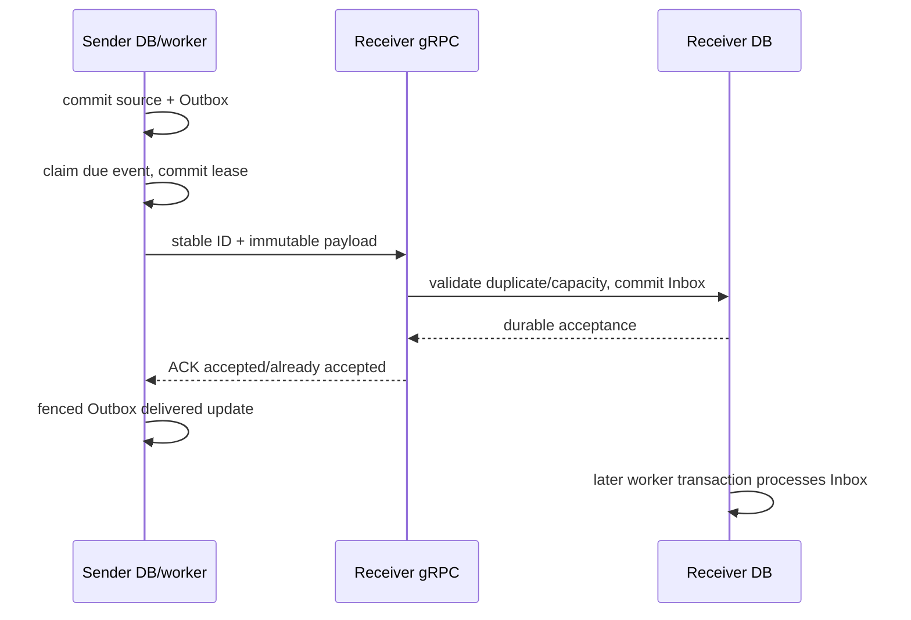

# Transactional Inbox/Outbox, gRPC and at-least-once delivery

A database commit and a remote call are two independent events. Sending before
commit can publish data that later rolls back. Sending after commit can lose the
notification if the process crashes between them. The Outbox makes the **intent to
send** part of the same local transaction as the source data.

## One hop, two services, several transactions

`ClaimDelivery` and `Published` in the two Outbox adapters are separate from
`Publisher.Publish`. No SQL transaction spans the network hop. Both receivers
return success only for explicit `DurablyAccepted` or `AlreadyAccepted` outcomes;
a nil/unimplemented acceptor cannot fabricate a successful ACK.

## Lost ACK, worked example

An event `raw-block/v1/1/N/H` is committed in Transformer Inbox. The response is
lost. Extractor retains its sending/pending intent and retries after its bounded
policy permits. Transformer finds the same ID and compares envelope and exact raw
content before accepting the duplicate. Extractor then marks its Outbox delivered.
A new event ID would defeat this mechanism; retries must preserve ID and content.

This is **at-least-once delivery with idempotent consumption**, not an exactly-once
network. If the same ID carries different content, the receiver rejects a conflict.
Extractor's source-store duplicate rule is different: an already stored full block
identity retains its first snapshot rather than overwriting it with a new acquisition.

## Completion and uncertainty

Transformer processing commits its result, Outbox and Inbox completion together.
Loader commits normalized rows and Inbox completion together. Application
`ProcessOne` deliberately returns `ErrCommitUnknown`/`ErrLeaseLost` without a second
failure mutation after completion uncertainty. A later read/claim distinguishes a
committed completion from expired unfinished work. A canceled caller is not proof
that PostgreSQL rolled back.

Read [Transformer ProcessOne](../../services/transformer-service/internal/application/usecases/process.go)
and [Loader Complete](../../services/loader-service/internal/adapters/outbound/postgres/complete.go).

## Error classification is a protocol decision

The outbound publishers disable implicit gRPC retries and make one call per
publication invocation under the caller context. Dispatch workers supply deadlines
and the durable use case schedules further attempts. Invalid payload/version/identity and oversize are terminal for
that immutable event; transient transport failure and receiver overload can return
to the durable retry loop. Stage 14 overload is `Unavailable` with the fixed
`RECEIVER_OVERLOADED` detail, while `ResourceExhausted` is reserved for size violations.
This avoids repeatedly sending a permanently oversized message.

A publication has a caller deadline, while durable Outbox attempts are counted
across cycles/restarts. There is no hidden publisher retry loop. A retryable error is not an unlimited promise to retry.
Exhaustion retains a visible failed row. Processing and dispatch use capped,
jittered exponential backoff; see their `backoff`/`deliveryBackoff` methods.

## Repair is not deletion

Restore dependencies and diagnose safe error codes first. Stage 13 repair grants a
finite additional allowance under an immutable operation ID and fences older claims.
Restart alone does not reset attempts. Replaying an already accepted event does not
force downstream transformation to run again. Reindex fetches source again and has
a separate range cursor; it is not a synonym for replay.

[ADR 0001](../adr/0001-mvp-transport-and-storage.md) chooses database queues over a
standalone broker for this MVP. This reduces infrastructure, but requires explicit
claim indexes, retained failed-work operations and database capacity management.
gRPC supplies a versioned transport, not message retention or a global ordering
service. See the [runbook](../architecture/operations-stage13.md) for exact repair
commands and the [handoff tests](../../test/integration/handoff/handoff_test.go)
for lost-ACK and duplicate assertions.
