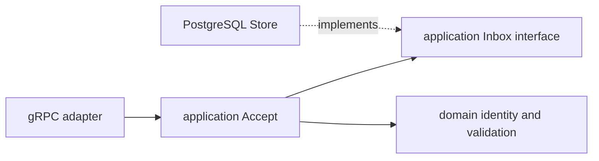

# Hexagonal Architecture and dependency inversion in Go

The useful boundary is between a decision and the mechanism that executes it.
Loader's application decides to accept an event only after validation; PostgreSQL
implements durable acceptance. Neither a socket nor a SQL connection is a domain value.

## Trace a real operation

Read these in order:

1. [Inbound port](../../services/loader-service/internal/application/ports/inbound/accept_block.go):
   `TransformedBlockAcceptor` accepts a plain Go request and returns an acceptance result.
2. [Use case](../../services/loader-service/internal/application/usecases/accept.go):
   `Accept` validates the request and invokes the outbound `Inbox` contract.
3. [Outbound port](../../services/loader-service/internal/application/ports/outbound/processing.go):
   `Inbox` describes a durable operation, without SQL statements or pgx result types.
4. [PostgreSQL adapter](../../services/loader-service/internal/adapters/outbound/postgres/store.go):
   `Store.Accept` owns transaction mechanics and duplicate comparison.
5. [Composition root](../../services/loader-service/cmd/loader/main.go):
   wires the concrete store into the use case and the use case into the receiver.

The runtime call reaches PostgreSQL, but the **source dependency** points from the
adapter to an interface owned by the application. This is dependency inversion.
Go's implicit interface satisfaction makes an inheritance framework unnecessary;
`var _ outbound.Inbox = (*Store)(nil)` documents a compile-time conformance check.

## Four representations, not one universal model

- Extractor's `domain.Extraction` retains exact bytes plus membership metadata.
- Transformer has its own typed `Snapshot`, `Quantity` and `Optional` types.
- Generated protobuf messages carry the event envelope across gRPC.
- PostgreSQL adapter arguments and metadata DTOs match persistence requirements.

A transaction quantity is an exact canonical decimal string in the normalized
model, not a float or an RPC hex token. Translating representations belongs in an
adapter; validating their meaning belongs in the domain/application. The Loader
JSON decoder consumes the normalized format, not Ethereum RPC JSON directly.

## Ports describe consumer needs

`BlockSource` is deliberately smaller than an Ethereum node SDK. `Queue` includes
claim, completion and failure operations because the worker needs those consistency
boundaries. A generic `Save(table, object)` interface would hide the atomicity
requirement. Conversely, the application should not expose `pgx.Tx`: that would
make an implementation detail part of the use-case contract.

The three service domains are intentionally separate even where value types look
similar. Sharing a domain package would couple independent changes. Technical
transport limits, metrics and log vocabulary are shared only outside those domains.

## Dependency injection and lifetime

The composition roots load configuration before starting work, open pools/listeners,
construct adapters/use cases and arrange shutdown. Constructors receive dependencies
explicitly; there is no global service locator. Background workers invoke inbound
ports, bound operation contexts, report progress, and join during cancellation.
Application constructors validate collaborators/settings but do not own the pool.

## Alternatives and trade-offs

Direct SQL in a gRPC handler is shorter initially, but couples transport testing to
storage and obscures ACK-after-commit. A shared framework would reduce repeated
wiring while making lifetime and transaction ownership harder to see. This project
chooses a little duplication and explicit wiring for inspectability. It does not
create empty layers simply to satisfy a diagram.

The [architecture tests](../../test/architecture/boundaries_test.go) parse imports
and schema references; they catch forbidden dependency directions and cross-service
internal access. They do not prove transaction semantics, security of arbitrary SQL,
or provider correctness. Those need adapter and integration tests.

Exercise without changing code: trace `ProcessOne` to `Queue.Complete` and identify
which interface could be replaced by an in-memory fake. Then identify which claims
still require PostgreSQL tests. See [ADR 0001](../adr/0001-mvp-transport-and-storage.md).
